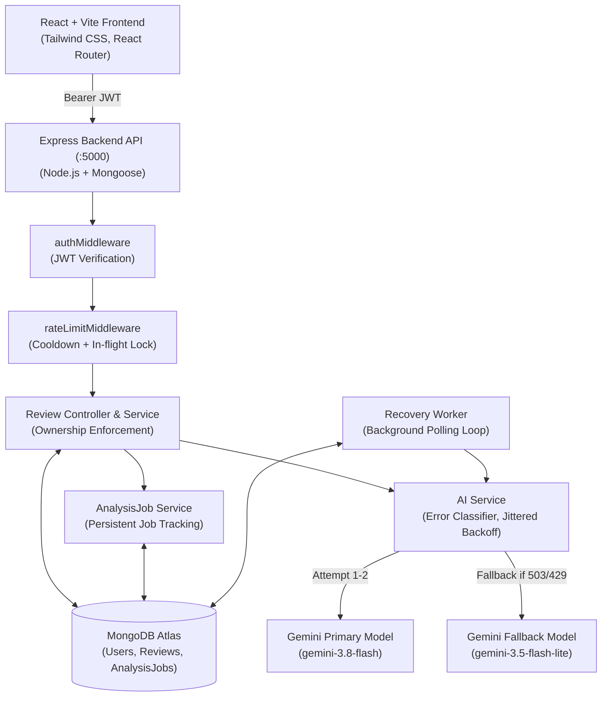

# AI-Powered Code Review & Mentorship Platform

An automated, full-stack code review and developer mentorship platform that provides static analysis, bug detection, security checks, and educational takeaways powered by Google Gemini, Node.js/Express, MongoDB, and React.

---

## Capabilities & Key Features

- **Multi-Language Support:** Static analysis for JavaScript, TypeScript, Python, Java, C++, and C codebases.
- **Tailored Review Focus:** Targeted evaluations prioritizing All, Bugs, Security, Performance, or Code Quality.
- **Structured Review Output:** Strictly validated schemas providing:
  - Overall quality score (0–100) with rating context.
  - Concise executive summary and identified code strengths.
  - Issues ordered strictly by severity (`critical` → `high` → `medium` → `low` → `info`).
  - Detailed explanation, "Why It Matters" rationale, suggested solution, and suggested code fix with one-click copy.
  - Actionable educational learning points for continuous developer mentorship.
- **Resilient AI Pipeline:**
  - Configurable primary model (`GEMINI_MODEL`, default: `gemini-3.8-flash`).
  - Automated fallback model (`GEMINI_FALLBACK_MODEL`, default: `gemini-3.5-flash-lite`) activated upon transient errors or quota exhaustion.
  - Bounded exponential backoff with jitter for transient 429/503/504 errors.
  - Fast-failure on permanent client errors (400, 401, 403, unsupported model).
- **Persistent Job State & Background Recovery:**
  - Asynchronous `AnalysisJob` tracking in MongoDB.
  - Background `recoveryWorker` that periodically claims due `retry_pending` jobs.
  - Safe crash recovery: in-flight jobs interrupted by server restart are automatically reset and queued for retry.
  - Non-destructive re-analysis: a failed re-run never deletes or overwrites an existing successful review result.
- **Real-Time Developer Dashboard:**
  - Real MongoDB aggregation statistics (total submissions, analyzed count, average score, top language, and most common issue category).
  - Cross-user data isolation: users only see their own metrics and reviews.
- **Security & Privacy Protections:**
  - Server-side AI isolation: API keys are strictly backend-only and never leak into frontend bundles or logs.
  - Source code is strictly statically analyzed; never evaluated (`eval`), compiled, or executed on the host system.
  - JWT authentication with bcryptjs password hashing and strict ownership verification on all endpoints.
  - In-memory cooldown rate limiter (`AI_ANALYZE_COOLDOWN_SECONDS`) and concurrency lock to eliminate duplicate submissions.

---

## Tech Stack

| Layer | Technology |
|---|---|
| **Frontend** | React 19, Vite, React Router 7, Tailwind CSS |
| **Backend** | Node.js, Express.js |
| **Database** | MongoDB Atlas with Mongoose ODM (in-memory MongoDB for tests) |
| **Authentication** | JSON Web Tokens (`jsonwebtoken`), `bcryptjs` |
| **AI Inference** | Google Gemini API via official `@google/genai` SDK |
| **Hosting (Target)** | Render (Web Service for Backend, Static Site for Frontend) |

---

## Architecture Overview



---

## Local Setup Instructions

### Prerequisites

- Node.js (v18+ recommended)
- MongoDB Atlas cluster URI or local MongoDB
- Google Gemini API Key from [Google AI Studio](https://aistudio.google.com/)

### 1. Repository Setup

```bash
git clone <repository-url>
cd "AI Code Review"
```

### 2. Backend Setup

```bash
cd backend
npm install
cp .env.example .env
```

Edit `backend/.env` with your credentials:

```env
PORT=5000
MONGODB_URI=mongodb+srv://<username>:<password>@<cluster>/<database>?retryWrites=true&w=majority
JWT_SECRET=your_generated_cryptographically_strong_secret
JWT_EXPIRES_IN=7d
FRONTEND_URL=http://localhost:5173
GEMINI_API_KEY=your_gemini_api_key_here
GEMINI_MODEL=gemini-3.8-flash
GEMINI_FALLBACK_MODEL=gemini-3.5-flash-lite
AI_ANALYZE_COOLDOWN_SECONDS=30
```

Start the backend:

```bash
# Development mode with watch
npm run dev

# Or standard start
npm start
```

Backend will run on `http://localhost:5000`.

### 3. Frontend Setup

In a separate terminal:

```bash
cd frontend
npm install
cp .env.example .env
```

Verify `frontend/.env`:

```env
VITE_API_URL=http://localhost:5000/api
```

Start the frontend:

```bash
npm run dev
```

Frontend will run on `http://localhost:5173`.

---

## Automated Test Suites

All tests run against an isolated in-memory MongoDB instance (`mongodb-memory-server`) to guarantee fast, safe, non-destructive execution:

```bash
# Days 21–25 Unified Resilience & Regression Suite (26 assertions)
node backend/scripts/testDay21_25.js

# Specific Test Suites
node backend/scripts/testUserModel.js      # User model validation & password hashing
node backend/scripts/testReviewModel.js    # Review model schema validation
node backend/scripts/testDay16.js          # Security, cooldown & rate-limit locks
node backend/scripts/testDay17.js          # AI evaluation & synthetic fixtures
node backend/scripts/testDay18.js          # Dashboard analytics & isolation
node backend/scripts/testE2E.js            # End-to-end integration flow

# Live Gemini Provider Smoke Test (1 real call, does not spam)
node backend/scripts/testSmokeGemini.js
```

---

## API Reference

### Authentication (`/api/auth`)

| Method | Endpoint | Description | Auth Required |
|---|---|---|---|
| `POST` | `/api/auth/register` | Register new user account | No |
| `POST` | `/api/auth/login` | Log in and receive signed JWT token | No |

### Code Reviews (`/api/reviews`)

| Method | Endpoint | Description | Auth Required |
|---|---|---|---|
| `GET` | `/api/reviews/stats` | Retrieve user-scoped dashboard statistics | Yes |
| `POST` | `/api/reviews` | Submit new code snippet for review | Yes |
| `GET` | `/api/reviews` | Retrieve authenticated user's review list | Yes |
| `GET` | `/api/reviews/:id` | Retrieve single review by ID | Yes |
| `DELETE` | `/api/reviews/:id` | Delete review by ID (deliberate confirmation) | Yes |
| `POST` | `/api/reviews/:id/analyze` | Trigger Gemini AI review (cooldown protected) | Yes |
| `GET` | `/api/reviews/:id/analysis-status` | Query active analysis job status for polling | Yes |

### Health Check (`/api`)

| Method | Endpoint | Description | Auth Required |
|---|---|---|---|
| `GET` | `/api/health` | Backend status check (`{ "success": true, "message": "API is running" }`) | No |

---

## Deployment Guide (Render & MongoDB Atlas)

### 1. MongoDB Atlas Configuration

1. In MongoDB Atlas, create a free M0 cluster.
2. Under **Network Access**, add `0.0.0.0/0` (Allow access from anywhere) so Render instances can connect.
3. Under **Database Access**, create a database user and record the username and password.
4. Copy the connection string (format: `mongodb+srv://<username>:<password>@<cluster>.mongodb.net/<database>?retryWrites=true&w=majority`).

### 2. Backend Deployment (Render Web Service)

1. Create a new **Web Service** on Render connected to this repository.
2. Set configuration:
   - **Root Directory:** `backend`
   - **Environment:** `Node`
   - **Build Command:** `npm install`
   - **Start Command:** `node src/server.js`
3. Add Environment Variables in Render Dashboard:
   - `PORT`: `10000` (Render default or omit)
   - `MONGODB_URI`: `<your-mongodb-atlas-uri>`
   - `JWT_SECRET`: `<generated-random-32-byte-hex>`
   - `JWT_EXPIRES_IN`: `7d`
   - `FRONTEND_URL`: `https://<your-frontend-subdomain>.onrender.com`
   - `GEMINI_API_KEY`: `<your-google-gemini-api-key>`
   - `GEMINI_MODEL`: `gemini-3.8-flash`
   - `GEMINI_FALLBACK_MODEL`: `gemini-3.5-flash-lite`
   - `AI_ANALYZE_COOLDOWN_SECONDS`: `30`
4. Deploy and verify health endpoint: `https://<your-backend-subdomain>.onrender.com/api/health`.

### 3. Frontend Deployment (Render Static Site)

1. Create a new **Static Site** on Render connected to this repository.
2. Set configuration:
   - **Root Directory:** `frontend`
   - **Build Command:** `npm install && npm run build`
   - **Publish Directory:** `dist`
3. Add Environment Variable:
   - `VITE_API_URL`: `https://<your-backend-subdomain>.onrender.com/api`
4. **Configure Single Page Application (SPA) Rewrite:**
   Under **Redirects/Rewrites** in the Render Static Site dashboard:
   - **Type:** `Rewrite`
   - **Source:** `/*`
   - **Destination:** `/index.html`
   *(This ensures client routes such as `/login`, `/dashboard`, `/reviews`, and `/review/:id` work after browser refresh).*

---

## Security & Privacy Considerations

1. **No Untrusted Execution:** Submitted code snippets are parsed exclusively as static text strings for heuristic evaluation. The server never executes, compiles, or passes code to system shells.
2. **Server-Side API Key Isolation:** `GEMINI_API_KEY` exists exclusively in the backend runtime. Vite bundles do not contain any AI keys.
3. **Log Redaction:** All application log output passes through `sanitizeLogMessage` in `backend/src/utils/logger.js`, redacting API keys, Bearer tokens, and sensitive headers.
4. **Ownership Verification:** All access queries strictly verify `review.user === req.userId`. Access attempts to reviews belonging to other users return HTTP 404 to prevent enumeration.
5. **Rate-Limiting & Spend Guard:** In-memory per-user and per-review cooldown prevents automated quota depletion and duplicate simultaneous API spend.

---

## Known Limitations

- **Model Context Limits:** Analysis input is limited to snippets up to 50,000 characters. Multi-file repository evaluations require breaking code into targeted components.
- **Heuristic AI Evaluations:** AI findings and scores represent automated static analysis guidance and do not guarantee 100% bug-free or secure software. Code reviews must be verified by engineers.
- **Provider Quota Dependencies:** Gemini free-tier keys may encounter transient HTTP 429 quota exhaustion during high-volume usage, which the platform mitigates via fallback models and scheduled retries.
